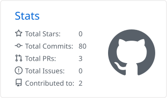
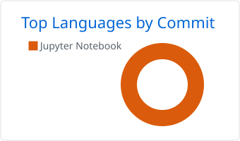
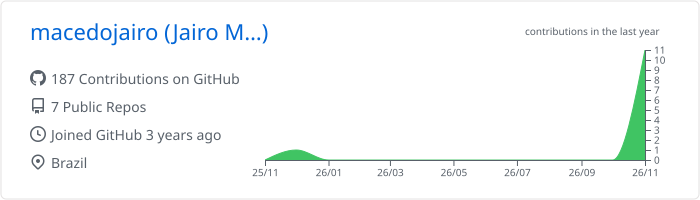

## Hi, I'm Jairo 👋

**Economist who codes.** I like hard questions with messy data behind them, and I spend most of my time figuring out what actually *causes* what.

---

### 🧭 What I'm into

- 🔍 **Causal inference.** Correlation is cheap. I care about the counterfactual: DiD, synthetic control, RDD, IV, and whatever the data allows.
- 🛠️ **Data that scales.** SQL, Athena and Polars on tables too big to open in Excel, built into pipelines that someone else can rerun.
- 📈 **Finance.** Markets, investment products and how information turns into prices.
- 🗣️ **Making numbers useful.** An estimate only matters when it changes a decision.

### ⚡ Quick facts

- 🏦 Senior Business Analytics at **Itaú Unibanco**
- 🎓 PhD candidate in Economics at **UFPE**

### 🧰 Tools I reach for

  
  
  
  
  
  
  
  
  
  
  

### 📊 GitHub Activity

  <picture>
    <source media="(prefers-color-scheme: dark)" srcset="./profile-summary-card-output/github_dark/3-stats.svg">
    
  </picture>
  <picture>
    <source media="(prefers-color-scheme: dark)" srcset="./profile-summary-card-output/github_dark/2-most-commit-language.svg">
    
  </picture>

  <picture>
    <source media="(prefers-color-scheme: dark)" srcset="./profile-summary-card-output/github_dark/0-profile-details.svg">
    
  </picture>

---

Always happy to talk data, causality and good coffee ☕
